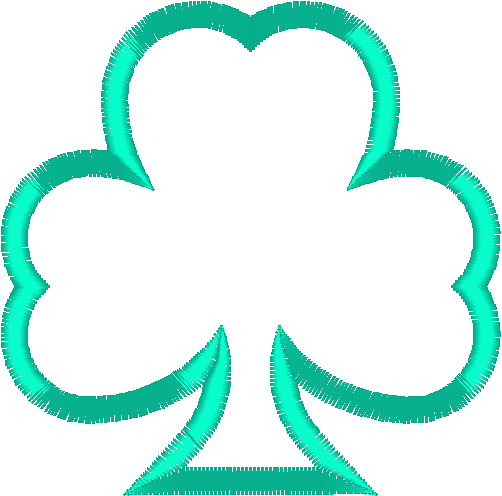
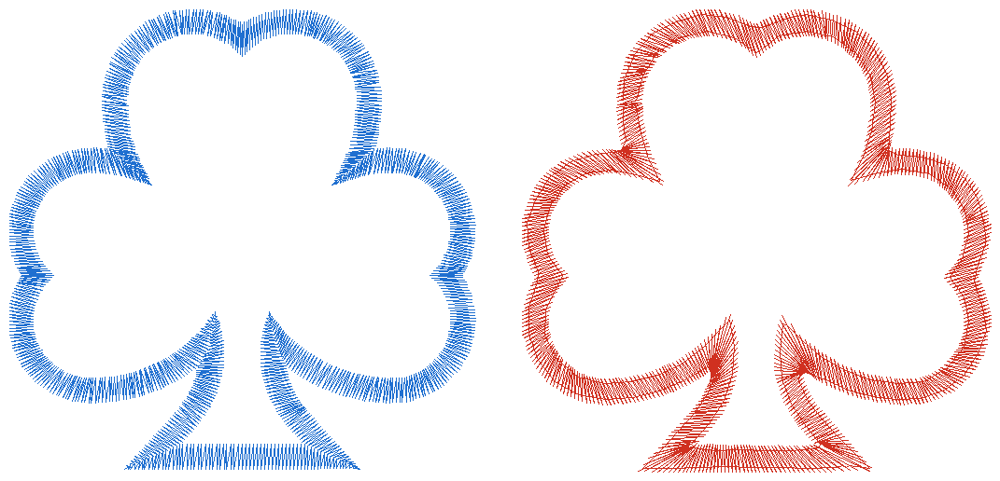
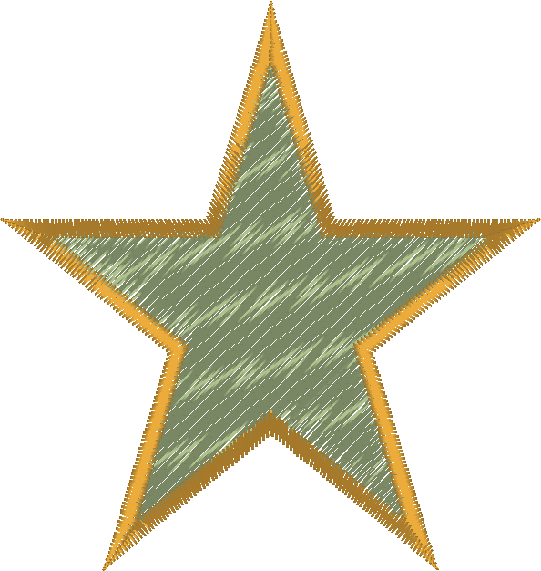
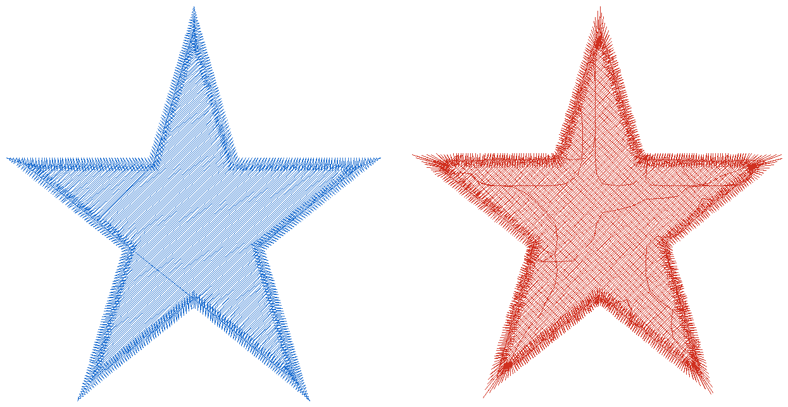

# Chaîne de broderie machine — dessin vers fichier DST

> ⚠️ **Avertissement — contenu généré par intelligence artificielle.** Ce document a été produit avec l'aide d'une IA (Claude, Anthropic) et n'a pas été validé par un spécialiste de la broderie machine. Il peut contenir des erreurs. Toute information, tout réglage et tout fichier produit — en particulier les fichiers machine (.dst) — doivent être vérifiés par un professionnel qualifié avant usage. **Un fichier machine erroné peut endommager la brodeuse** (casse d'aiguille, bourrage, contrainte mécanique), abîmer le tissu et présenter un risque pour l'opérateur : ne jamais lancer une broderie sans contrôle préalable par un spécialiste et premier essai à vitesse réduite, sur chute de tissu.

Archive du 16 novembre 2026 (version 1.0 du processus, après revue critique). Processus générique pour produire un fichier de broderie machine **DST (Tajima)** à partir d'un dessin vectoriel ou d'une image, par la chaîne **Inkscape + Ink/Stitch + Python**.

## À quoi sert ce dépôt

Transformer automatiquement un dessin vectoriel ou une image en fichier de broderie machine (DST, format Tajima), avec Inkscape, Ink/Stitch et Python. Le principe directeur : **la chaîne refuse de produire un fichier qu'elle ne sait pas vérifier**. Elle s'arrête avant l'export quand une forme ne peut pas être brodée correctement, et une grille de vérification mesure le résultat sur des critères de broderie (direction et densité des points, sous-couche, longueurs, coupes) et pas seulement sur la ressemblance de la silhouette.

## Ce qui a été réalisé

- **Savoir et spécification** : collecte des connaissances (≈ 280 sources), exigences mesurables, architecture, processus en version 1.0 après une revue critique indépendante.
- **Installation** : guide pas à pas vérifié sur une installation propre d'Ubuntu 24.04.
- **Prototype de chaîne complète** : traçage, mise à l'échelle, détection des défauts avec corrections appliquées seulement après approbation, classement des formes, satin avec garde, séquençage par recouvrements, exécution d'Ink/Stitch en programme séparé, lecture brute du DST.
- **Grille de vérification exécutable**, validée par mutation : chaque défaut volontaire applicable au dessin est détecté.
- **Tests automatiques** et essais techniques du comportement d'Ink/Stitch (`spikes/`).
- **Deux essais complets**, aux résultats rapportés tels quels : les deux sont **refusés** par la grille. Sans approbation, la chaîne **s'arrête** comme prévu. Le défaut restant : des points de satin en biais aux angles vifs. Pour l'étoile, la densité du remplissage rejoint celle de l'original.

## Essais : entrées et résultats

Entrée de chaque essai : le rendu PNG d'un fichier DST connu (Embroidermodder). Résultat : le fichier d'origine en **bleu**, le nôtre en **rouge** (configuration de production, approbation forcée pour l'essai).

| Essai | Entrée | Résultat (original en bleu, nous en rouge) |
|---|---|---|
| N° 1 — trèfle (une couleur, satin) |  |  |
| N° 2 — étoile (deux couleurs, remplissage + bordure satin) |  |  |

- **Trèfle** — refusé : points de satin en éventail aux angles rentrants (pointes de la tige, creux entre les lobes). Détail : `prototype/essais/trefle/rapport_essai_trefle.md`.
- **Étoile** — refusée : pointes raccourcies et bordure trop lourde ; le remplissage a une densité comparable à l'original. Détail : `prototype/essais/etoile/rapport_essai_etoile.md`.

**Suite** : découper le satin aux angles vifs, puis un essai sur un vrai dessin vectoriel à deux tailles, avec des critères figés avant l'exécution.

## Contenu

| Chemin | Contenu |
|---|---|
| `exigences_broderie.md` | Exigences mesurables (quoi), avec essais nommés et statuts |
| `architecture_broderie.md` | Architecture (comment) : composants, conventions d'unités, algorithmes, mesures de qualité, essais |
| `processus_broderie.md` | Processus générique (étapes, décisions, contrôles) et suivi des points ouverts |
| `collecte_de_savoir_broderie.md` | Référence des connaissances et de toutes les sources (≈ 280) |
| `critique_fable.md` | Revue critique indépendante (16/11/2026) à l'origine de la version 1.0 |
| `critique_scratch/exp*.py` | Scripts d'expérience de la revue critique (preuves ; fichiers intermédiaires non inclus) |
| `guide_installation_broderie.md` | Guide d'installation pas à pas (Ubuntu 24.04, vérifié sur installation propre) |
| `verifier_installation.py` | Script de vérification de l'installation (export et relecture d'un dessin de test) |
| `prototype/chaine/` | Prototype : traçage, mise à l'échelle, détection et corrections approuvées, mesure, classement, satin avec garde, séquençage, exécution d'Ink/Stitch, lecture brute, mesures de qualité, grille de vérification, fiche couleurs |
| `prototype/essai_dessin.py` | Montage d'essai : rendu d'un DST connu → chaîne → vérification et comparaison (codes 0 accepté, 1 refusé, 2 arrêt) |
| `prototype/mutations.py` | Validation de la grille par mutation |
| `prototype/tests/` | Tests automatiques |
| `prototype/essais/trefle/`, `prototype/essais/etoile/` | Essais n° 1 et 2 (rapports v2.0 ; dossiers `essai/` et `production/` : SVG paramétré, DST, fiche couleurs, images, rapport JSON, résultats de mutation) |
| `spikes/results/` | Essais techniques d'Ink/Stitch (rapport `SPIKES_REPORT.md`, fichiers produits, aperçus) |
| `spikes/tests/` | SVG d'entrée de ces essais techniques |
| `spikes/tools/` | Scripts d'inspection des DST produits par ces essais (blocs, en-tête brut, relecture) |
| `samples_dst/` | Fichiers DST d'exemple (Embroidermodder, licence zlib incluse) et inventaire |
| `tools/` | Petits outils : lecture d'en-tête DST, rendu PNG d'un DST, inspection des sources |
| `renders/` | Rendus PNG des DST d'exemple (entrées des essais) et des fichiers DXF associés |

## Non inclus (à reconstruire)
- Code d'Ink/Stitch et environnement Python : suivre `guide_installation_broderie.md`.
- Dépôt Embroidermodder complet : https://github.com/Embroidermodder/Embroidermodder (commit `537c9dd`).

## Relancer un essai
Après installation (guide `guide_installation_broderie.md`), depuis la racine du dépôt, `inkstitch/` étant le dossier Ink/Stitch du guide :
```bash
uv sync --locked
uv run python prototype/essai_dessin.py trefle renders/shamrockin.png samples_dst/embroidermodder/shamrockin.dst inkstitch/inkstitch.py 1
uv run python prototype/essai_dessin.py etoile renders/star.png samples_dst/embroidermodder/Star.DST inkstitch/inkstitch.py 2
```
Ajouter `--config essai|production` et `--approuver-tout` (essais seulement). Résultats attendus : sans approbation, **arrêt** (code 2, garde du satin) ; avec approbation d'essai, **refus** par la grille (code 1) pour les deux dessins — voir les rapports v2.0. Tests : `uv run pytest` (le test qui appelle Ink/Stitch demande `INKSTITCH=<chemin vers inkstitch.py>`, sinon il est sauté).

## Licences
- Fichiers DST d'exemple : licence zlib (Embroidermodder), voir `samples_dst/embroidermodder/LICENSE.md`.
- Ink/Stitch (non inclus) : GPL-3.0 ; il est appelé comme programme séparé, son code n'est pas importé.
